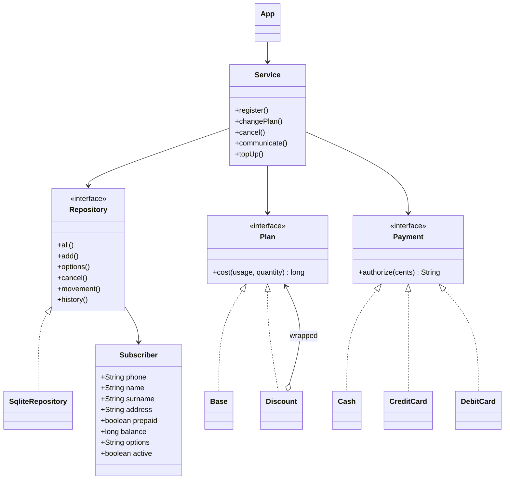

# Gestore telefonico 1 — Relazione di progetto

**Studente:** Ylenia Cecere  
**Matricola:** 0124002397  
**Gruppo:** x3z0871zba — un componente

## Requisiti e scelte progettuali

L'applicazione standalone Java permette all'amministratore di registrare, modificare il piano e disdire abbonamenti. L'abbonato simula chiamate, SMS, trasferimenti dati e ricariche. Ogni abbonato possiede nome, cognome, residenza, numero, piano e conto fisso o ricaricabile. Swing realizza l'interfaccia, SQLite conserva anagrafiche e movimenti.

Due pagine distinte gestiscono l'accesso. L'amministratore è predisposto dal sistema con username `admin` e password `admin`; `AdminAccess` verifica queste credenziali fisse senza registrazione, anche dopo il logout. L'abbonato accede con il solo numero, previamente registrato e attivo, e visualizza esclusivamente la propria utenza. Questo accesso identifica il numero ma non verifica l'identità della persona. Input errati, credenziali non valide e utenze disdette producono messaggi di errore.

Le chiamate hanno durata dichiarata in secondi e costo per minuto iniziato. SMS e dati sono quantificati rispettivamente in messaggi e MB interi. Le tariffe base sono 0,20 €/minuto, 0,10 €/SMS e 0,02 €/MB. Le opzioni dimezzano il costo della categoria, senza canoni. Il conto fisso accumula addebiti, mentre quello ricaricabile impedisce operazioni senza credito sufficiente. Le utenze disdette scompaiono dall'elenco operativo e rimangono nell'archivio amministrativo, con storico consultabile e operazioni disabilitate.

## Diagramma UML delle classi

Il diagramma è scritto in Mermaid; esportarlo come immagine per la relazione finale.



`Base` e `Discount` sono classi annidate in `Plan`; `Cash`, `CreditCard` e `DebitCard` sono annidate in `Payment`.

## Design pattern

**Decorator.** L'interfaccia `Plan` definisce il calcolo dei costi. `Base` implementa il piano iniziale. `Discount` contiene un altro `Plan` e modifica solo il prezzo della categoria selezionata. Più decorator consentono di combinare le opzioni senza creare una classe per ogni combinazione.

```java
long price = wrapped.cost(usage, quantity);
return usage == category ? (price + 1) / 2 : price;
```

**Strategy.** `Service.topUp` riceve una strategia `Payment`, senza dipendere dalle classi di pagamento concrete. Contanti, carta di credito e bancomat producono una descrizione dell'autorizzazione simulata. Condividono la validazione dell'importo; la carta controlla inoltre numero di 16 cifre, intestatario, CVV di 3 cifre e scadenza MM/AA non passata; il bancomat controlla un PIN di 5 cifre. Il modulo mostra i campi del metodo selezionato e maschera CVV e PIN. Sono utilizzati dati fittizi, senza comunicazioni bancarie: i dettagli non vengono persistiti o inclusi nelle ricevute.

```java
String receipt = payment.authorize(cents);
repository.movement(phone, cents, "Ricarica — " + receipt);
```

## Principi SOLID

- Responsabilità singola: interfaccia, casi d'uso, calcolo tariffario e persistenza sono separati.
- Aperto/chiuso: nuove strategie di pagamento e implementazioni di piano possono essere aggiunte senza modificare il servizio di addebito. Il catalogo delle opzioni e l'interfaccia vanno comunque aggiornati quando cambia il prodotto.
- Sostituzione di Liskov: piani e pagamenti rispettano le operazioni definite nelle rispettive interfacce.
- Segregazione delle interfacce: `Plan` e `Payment` espongono una sola operazione applicativa ciascuna.
- Inversione delle dipendenze: `Service` riceve un `Repository`, non costruisce una connessione SQLite.

## Persistenza, eccezioni e correttezza

La tabella `subscribers` contiene anagrafica, conto e opzioni; `movements` conserva data, descrizione e variazione del saldo, con chiave esterna all'abbonato. Il numero di telefono è univoco. Le query parametrizzate separano dati e istruzioni SQL. Gli importi sono interi in centesimi per evitare errori dei numeri floating point.

L'aggiornamento del saldo controlla atomicamente lo stato attivo e il credito. Aggiornamento e inserimento del movimento sono racchiusi in una transazione: in caso di errore viene eseguito il rollback. Gli errori di input producono `IllegalArgumentException`, quelli di persistenza `IllegalStateException`; Swing visualizza un messaggio comprensibile.

## Verifica e limiti

I test automatici coprono arrotondamento delle chiamate, combinazione delle opzioni, credito insufficiente senza movimenti residui, ricariche e importi non validi, conto fisso, destinatari e disdette, persistenza dopo riapertura. La verifica manuale dell'interfaccia richiede un ambiente desktop e deve includere l'intero flusso riportato nel README.

Non sono simulate reti telefoniche reali, transazioni bancarie, autenticazione dell'identità dell'abbonato, fatturazione mensile o comunicazioni con altri gestori. Questi limiti delimitano il progetto didattico.

Prima della consegna integrare la relazione con immagini dell'interfaccia, esportare UML e documento in PDF e allegare il PDF originale della prova. Questa relazione costituisce una bozza da rivedere e comprendere prima dell'esame.
